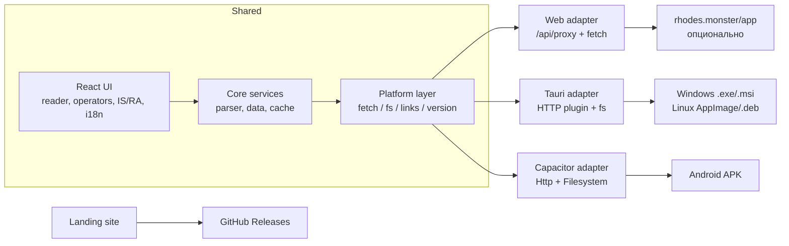

# План миграции: веб-приложение → приложения для ПК и Android

Статус: обновлено 2026-11-15.

> **Решение от 2026-11-15: десктоп отменён.** Выпускаем только сайт и
> Android-приложение. Причины: WebKitGTK не проигрывает hero-видео и ведёт себя
> иначе в остальном, а неподписанный Windows-установщик требует отдельной
> сборки в CI и пугает SmartScreen. Код Tauri-оболочки удалён из рабочего
> дерева, чтобы не тащить мёртвые зависимости; вернуться к нему можно новым
> `tauri init` — общий `src/` и платформенный слой к этому готовы.
> Разделы 3.4/3.5/3.6 про Tauri и Windows оставлены как история решений.

Статус: черновик, 2026-11-09.
Цель: терминал, читалка и архив оперативников становятся скачиваемыми приложениями
(Windows/Linux + Android), а `rhodes.monster` превращается в статическую визитку
с описанием и кнопками загрузки.

## Решения от 2026-11-09

- Платформы: **Windows + Linux** и **Android**. macOS не делаем.
- Дистрибуция: **только GitHub Releases** (установщики и APK). Google Play и
  macOS App Store не используем.
- Офлайн: **трёхуровневый режим** — онлайн-кэш, частичный офлайн (прочитанное)
  и полный офлайн выбранных линий/паков (см. раздел 3.2).
- Веб-версия: остаётся в репозитории только как источник общего кода и
  локальное демо для разработки. Из публичных ссылок, навигации, sitemap и
  лендинга убирается полностью.
- Контент не храним и не перепаковываем: текст, картинки и аудио качаются
  напрямую с `torappu.prts.wiki`, `raw.githubusercontent.com` (Kengxxiao и др.)
  и jsDelivr. Наши GitHub Releases — только бинарники приложений.
- Текст: сразу после запуска в фоне качаются **все** сценарии выбранных языков
  (≈5 869 файлов на язык), строго по одному запросу. Манифест путей вшит в
  приложение; текущая глава имеет приоритет, остальное докачивается в фоне
  и переживает перезапуск. Соединение — любое, без ограничения Wi-Fi.
- Язык офлайн-текста выбирается в настройках: `zh_CN`, `en_US`, `ja_JP`,
  `ko_KR` и русский (база `zh_CN` + CSV-overlay).
- Картинки, музыка и звуки: только в момент, когда пользователь открывает
  или явно скачивает главу.
- Обновления контента: внешние источники обновляются сами, мы проверяем
  свежесть кэша по ETag/Last-Modified/хэшам. Своего релиза данных нет.
- Голос: скачивается автоматически при открытии оперативника, по одному файлу.
- Подпись Windows: на старте — **неподписанная бета** с SHA-256 в релизе;
  сертификат рассматриваем позже (см. 3.8).

---

## 1. Что есть сейчас

| Компонент | Сейчас |
|---|---|
| Фронтенд | React 19 + TypeScript + Vite 6, Tailwind 4, Motion, Howler |
| Бэкенд | Express 4 (`server.ts`) + Vercel serverless |
| Маршруты API | `/api/proxy`, `/api/bug-report`, `/api/submit` |
| Данные | `public/data` — 320 КБ JSON (индекс истории, операции, галерея, терминал) |
| Сценарии | ~5 869 `.txt` (~75 МБ) тянутся с PRTS/GitHub по требованию и кэшируются |
| Ассеты | `public/assets` — 18 МБ (терминал 11 МБ, `monster_loop.mp4` 6.4 МБ) |
| Арт/аудио | внешние CDN: `torappu.prts.wiki`, `fastly.jsdelivr.net`, `wsrv.nl` |
| Досье | таблицы с jsDelivr, кэш в Cache Storage на 7 дней |
| PWA | `vite-plugin-pwa`, `registerType: autoUpdate` |
| Деплой | Vercel (Hobby) + Cloud Run |
| Прокси | SSRF-защита, allowlist хостов, rate-limit 10 000 / 15 мин на IP |

Использование `/api/proxy` в коде: `audioManager`, `operatorService`,
`operatorVoiceService`, `storyTreeService`, `imageFallback` (5 точек).
Прямых `fetch('/data/...')` — 5 (App, MainThemeStoryView ×3, CsvExportPage).

---

## 2. Целевая архитектура



### Рекомендуемый стек

| Платформа | Технология | Почему |
|---|---|---|
| Windows / Linux | **Tauri 2** | Переиспользует текущий `dist`, установщик 10–20 МБ, нативные HTTP/FS/updater, WebView2/WebKitGTK |
| Android | **Capacitor 7** | Зрелая обёртка WebView, минимум переписывания, нативные Http/Filesystem/App |
| Сайт | **Vite + React** или Astro, статика | Нет сервера, деплой на Vercel Hobby |
| Общий код | текущий `src/` | Парсер, читалка, каталог, стили и переводы остаются |

Почему не Electron: +100 МБ и Node-сервер внутри, хотя позволил бы сохранить
`/api/proxy` почти без изменений. Для фан-приложения размер и память важнее.

Почему не Tauri для Android на первом этапе: поддержка есть, но плагины и
сборка менее предсказуемы; Capacitor даёт более короткий путь к рабочему APK.
При желании Android можно позже перевести на Tauri без смены UI.

---

## 3. Ключевые технические решения

### 3.1. Убрать зависимость от `/api/proxy`

В приложении серверного прокси нет. Варианты по хостам:

1. **Прямой запрос из WebView** — у `torappu.prts.wiki` и jsDelivr открыт CORS,
   большинство картинок/скриптов можно грузить напрямую.
2. **Нативный HTTP** — Tauri `@tauri-apps/plugin-http` и Capacitor `@capacitor/http`
   обходят CORS для остальных хостов.
3. **Локальный кэш** — вместо прокси использовать файловый кэш приложения.

План: ввести `src/platform/` и заменить все пять точек на `platform.fetch` /
`platform.resolveAsset`. Веб-адаптер сохраняет текущий `/api/proxy`,
десктоп/Android — нативный HTTP. Серверные маршруты остаются только для веба.

### 3.2. Данные и офлайн-режим

Источники контента: `torappu.prts.wiki`, `raw.githubusercontent.com`
(`Kengxxiao/ArknightsGameData`, `neponum/zoot-data` и др.), jsDelivr.
Мы ничего не храним у себя и не делаем собственных архивов контента.

Три уровня:

1. **Онлайн (по умолчанию).** Всё тянется по требованию, прочитанное кэшируется.
2. **Частичный офлайн.** Автоматически сохраняются открытые главы: текст сценария,
   фоны/CG/спрайты и уже прослушанное аудио. Доступно без сети; квота с LRU.
3. **Полный офлайн выбранного.** Пользователь скачивает конкретные главы или
   сюжетные линии: приложение последовательно тянет файлы из источников в
   локальный кэш с прогрессом, докачкой и проверкой целостности.

#### 3.2.1. Первый запуск и синхронизация текста

- В установщик вшиваются JSON-каталоги (`public/data`) и манифест путей
  `story/scripts.json` (262 КБ, 5 869 сценариев). Сами тексты не вшиваются.
- После запуска автоматически стартует фоновая очередь: по одному запросу
  скачивается каждый сценарий с torappu/raw GitHub в локальный кэш.
- Приоритет: глава, которую открыл пользователь, встаёт в начало очереди.
- Прогресс и состояние очереди сохраняются; после перезапуска загрузка
  продолжается с места остановки.
- Очередь можно поставить на паузу; в настройках видно «скачано X из 5 869».
- Обновление: проверяем `ETag`/`Last-Modified`/хэш и перекачиваем только
  изменившиеся файлы. Нашего ежемесячного релиза данных нет.
- Оценка времени: при 1 запросе и задержке 200–500 мс — от ~20 до ~50 минут
  на один язык; это фон, чтение не блокируется.
- Ориентир по объёму: ~75 МБ сырого текста на официальный язык, все четыре —
  ~300 МБ; русский — те же ~75 МБ базы плюс несколько МБ overlay-файлов.

#### 3.2.1.1. Выбор языка

- В настройках — список языков с галочками и оценкой размера.
- По умолчанию выбран язык интерфейса/читалки.
- Русский: качается база `zh_CN` + CSV-overlay из `neponum/zoot-data`
  (`translation/ru_RU/<глава>/...csv`); при чтении overlay накладывается как сейчас.
- Очередь общая: при нескольких языках файлы качаются по одному, без пачек.
- Переключение языка не удаляет уже скачанное; в «Хранилище» видно занятое
  место по каждому языку отдельно.

#### 3.2.2. Голос по оперативнику

- При открытии оперативника загружается его таблица реплик и **автоматически**
  скачиваются аудиофайлы выбранного языка (по одному, с кэшем).
- В карточке есть «Удалить озвучку» и повторная загрузка.
- Глобальных паков `voice:<lang>` нет: это десятки гигабайт и лишний трафик.

#### 3.2.3. Формат локального кэша

- Не zip-паки, а обычные файлы в кэше приложения с сохранением структуры URL.
- Для каждого файла — запись с URL, версией/ETag, размером, датой и хэшем.
- Очистка — LRU; «Хранилище» показывает занятое место по категориям
  (сценарии, арт, аудио, голос).

### 3.3. Кэш и файлы

- Веб: Cache Storage + IndexedDB (как сейчас).
- Tauri: `plugin-fs` + `appCacheDir`, плюс Cache Storage внутри WebView.
- Capacitor: `@capacitor/filesystem` (Directory.Cache/Data) и Cache Storage.
- Единый интерфейс `platform.cache` с `get/put/stats/clear`.

### 3.4. Аудио

- Онлайн: прямые URL, как сейчас.
- Офлайн: скачанный файл → `convertFileSrc` (Tauri) или `Capacitor.convertFileSrc`.
- Howler продолжает работать; меняется только источник URL.

### 3.5. Обновления

- **Tauri**: `plugin-updater`, подписанный `latest.json` в GitHub Releases.
- **Android**: проверка версии по GitHub Releases API, скачивание APK и
  системный установщик (`Intent.ACTION_VIEW`); либо Obtainium.
- **Google Play** — только после юридической проверки; на старте прямой APK.

### 3.6. Платформенные мелочи

- Android back: закрыть модалку/читалку → история → выход (`@capacitor/app`).
- Safe area: `env(safe-area-inset-*)` для вырезов и жестовой навигации.
- Внешние ссылки: `opener` / `Browser.open`, а не `<a target=_blank>`.
- Сохранение CSV: нативный диалог (`dialog` / `Share`).
- PWA-плагин отключается для сборок Tauri/Capacitor.
- Версия приложения: `package.json` → `tauri.conf.json` / `versionCode`.

### 3.8. Подпись Windows

| Вариант | Стоимость | Сложность | SmartScreen |
|---|---|---|---|
| Без подписи | 0 | нет | «Неизвестный издатель», кнопка «Всё равно запустить» |
| Self-signed | 0 | низкая | предупреждение остаётся, пользователям не помогает |
| OV-сертификат | ~$200–400/год | средняя: юрлицо, HSM/облачное хранилище ключей, CI | репутация набирается постепенно |
| EV-сертификат | ~$300–600/год | высокая: HSM, проверка компании | обычно сразу без предупреждения |
| Azure Trusted Signing | ~$10/мес | низкая, но нужна проверяемая история компании | хороший вариант, если подходим по требованиям |

Для бесплатного фан-проекта разумно: **бета без подписи** + SHA-256 и
инструкция в релизе. Если появится поток загрузок — Azure Trusted Signing
или OV. Подпись не влияет на работу приложения, только на предупреждение Windows.

### 3.7. Что остаётся только на сайте

- `/api/submit` — отправка переводов (онлайн-воркфлоу).
- `/api/bug-report` — можно оставить на сайте; в приложении заменить на
  GitHub Issue или `mailto`.
- PWA-установка, SEO, sitemap, аналитика Vercel.

---

## 4. Структура репозитория

Минимальный путь без полной монорепы:

```text
ZOOT-ARCHIVE/
  src/                  # общий UI и core
  src/platform/         # web.ts, tauri.ts, capacitor.ts, index.ts
  public/               # data + assets
  src-tauri/            # десктоп-оболочка
  android/              # Capacitor-проект
  server/               # только для веба
  site/                 # новая визитка (или отдельный репозиторий)
  .github/workflows/    # release-desktop, release-android, deploy-site
```

Если позже понадобится несколько приложений — вынести `src/` в
`packages/core` + `packages/ui` и подключить npm workspaces. На первом этапе
это лишняя сложность.

---

## 5. Этапы

Оценки — для одного разработчика, без учёта ожидания ревью сторов.

### Этап 0. Подготовка (2–3 дня)

- Зафиксировать текущий веб-релиз тегом (`web-v1`), чтобы иметь точку возврата.
- Ответить на открытые вопросы (раздел 9).
- Завести `src/platform/` с интерфейсом и веб-адаптером (без переноса логики).
- Настроить GitHub Actions: lint + build на PR.

**Готово, когда:** веб собирается как раньше, CI зелёный.

### Этап 1. Абстракция платформы и отказ от прокси (4–6 дней)

- `platform.fetch`, `platform.resolveAsset`, `platform.dataUrl`.
- Заменить 5 использований `/api/proxy`.
- Заменить 5 прямых `fetch('/data/...')` на `platform.dataUrl`.
- Манифест сценариев: `scripts/build_story_scripts_manifest.mjs` → `story/scripts.json`.
- Проверить чтение, операторов, озвучку, досье, CSV-экспорт.

**Готово, когда:** веб работает без регрессий, приложение не знает про `/api`.

### Этап 2. Tauri desktop beta (7–10 дней)

- `src-tauri` с `frontendDist: ../dist`.
- Плагины: `http`, `fs`, `dialog`, `opener`, `updater`, `window-state`.
- CSP, иконки, размеры окна, single-instance.
- Кэш артов/сценариев в `appCacheDir`.
- Установщики: NSIS/MSI (Windows), AppImage/deb (Linux).

**Готово, когда:** установленное приложение открывает читалку, операторов,
IS/RA; глава грузится без сервера; настройки сохраняются.

### Этап 3. Android beta (7–10 дней)

- `npx cap add android`, `@capacitor/http`, `filesystem`, `app`, `browser`,
  `share`, `status-bar`, `splash-screen`.
- Back-навигация, safe-area, блокировка поворота там, где нужно.
- Кэш и офлайн-поведение, обработка отсутствия сети.
- Подпись APK, `versionCode`, `minSdk 24`, `targetSdk 35`.

**Готово, когда:** APK ставится на чистое устройство, читалка и архив работают,
back не выкидывает из приложения.

### Этап 4. Офлайн-загрузки и хранилище (10–14 дней)

- Фоновая очередь текста: автозапуск, приоритет текущей главы, пауза/продолжение,
  сохранение прогресса между запусками.
- Экран «Хранилище»: занято, лимит, очистка по категориям, «скачано X из 5 869».
- Открытие/скачивание главы: подгрузка арта, музыки и звуков (по одному запросу).
- Автозагрузка голоса при открытии оперативника + удаление.
- Проверка свежести по ETag/Last-Modified, перекачка только изменённого.
- LRU-эвикция при превышении квоты.
- Проверка: глава и линия читаются в самолётном режиме.

**Готово, когда:** глава читается в самолётном режиме после скачивания.

### Этап 5. Сайт-визитка (4–6 дней)

- Новая статика: hero, скриншоты, фичи, требования, changelog, FAQ, legal.
- Кнопки: Windows, Linux, Android APK; версия и дата из `releases.json`.
- Ссылки на GitHub Releases, дисклеймер, приватность.
- Убрать из публичной навигации веб-терминал; при желании оставить `/app`
  как демо, но не поддерживать две ветки функционала.

**Готово, когда:** сайт не содержит серверных вызовов и деплоится на Hobby.

### Этап 6. Релиз и QA (5–7 дней)

- Матрица: Windows 10/11, Ubuntu 22.04/24.04, Android 8/10/14.
- Проверка звука, видео, длинных глав, лимитов кэша, back, поворотов.
- Подпись Windows (опционально), Android keystore, updater-ключи.
- Документация: сборка, релиз, откат.

**Итого:** ~5–7 недель плотной работы; при занятости по вечерам — 2–3 месяца.

---

## 6. Изменения по файлам

| Файл / каталог | Что делаем |
|---|---|
| `src/platform/index.ts` | новый интерфейс платформы |
| `src/platform/web.ts` | текущее поведение: `/api/proxy`, Cache Storage |
| `src/platform/tauri.ts` | HTTP-плагин, fs-кэш, opener, updater |
| `src/platform/capacitor.ts` | Http, Filesystem, App, Browser |
| `src/services/story/storyTreeService.ts` | `fetchWithFallback` → `platform.fetch` |
| `src/services/story/storyAssetService.ts` | прямые CDN + платформенный кэш |
| `src/services/operatorService.ts` | убрать `/api/proxy` |
| `src/services/operatorVoiceService.ts` | убрать `/api/proxy`, нативные ссылки |
| `src/services/audioManager.ts` | источник файла через платформу |
| `src/lib/imageFallback.ts` | fallback-цепочка без веб-прокси в приложениях |
| `src/App.tsx`, `MainThemeStoryView.tsx`, `CsvExportPage.tsx` | `platform.dataUrl` вместо `/data/...` |
| `vite.config.ts` | PWA только для веб-сборки |
| `src-tauri/*` | конфиг, capabilities, иконки, updater |
| `android/*` | Capacitor-проект, gradle, keystore |
| `scripts/build_story_scripts_manifest.mjs` | манифест путей всех сценариев |
| `src/services/storyTextSync.ts` | фоновая очередь загрузки текстов (новый) |
| `site/*` | визитка и ссылки на Releases |
| `.github/workflows/*` | сборка и релизы |

---

## 7. CI/CD и релизы

```text
push tag v1.2.3
  ├─ release-desktop.yml  (windows-latest, ubuntu-22.04)
  │    npm ci → npm run build → tauri build → artifacts
  ├─ release-android.yml  (ubuntu, JDK 21, Android SDK)
  │    npm ci → npm run build → cap sync → gradlew assembleRelease
  └─ GitHub Release: exe/msi, AppImage/deb, apk, latest.json
        └─ site читает releases.json / GitHub API и показывает кнопки
```

- Версия — единый источник в `package.json`; скрипт `npm run version:bump`.
- Артефакты подписываются; updater-ключ хранится в secrets.
- Сайт деплоится отдельно (Vercel Git integration), без доступа к секретам сборки.

---

## 8. Риски и ограничения

| Риск | Митигация |
|---|---|
| PRTS rate-limit / 404 | последовательная загрузка, зеркала jsDelivr/raw, нативный HTTP, retry |
| Google Play отклонит фан-приложение с чужими ассетами | на старте APK + GitHub Releases/itch.io; Play — позже |
| Большой размер приложения | не вшивать сценарии/аудио; ассеты 18 МБ; паки по желанию |
| Разные WebView на Android | minSdk 24, тесты на старых устройствах, полифиллы |
| Потеря кэша Android | durable-кэш в Filesystem, а не только Cache Storage |
| Две кодовые базы разъедутся | общий `src/`, платформенный слой, один UI |
| Юридические претензии | дисклеймер, некоммерция, takedown-страница, ассеты по возможности не распространять |
| Vercel Hobby | сайт статический; приложения не ходят через Vercel |

---

## 9. Открытые вопросы

1. Какие языки включить по умолчанию: только язык интерфейса или `zh_CN` + `ru`?
2. Когда возвращаться к подписи Windows: сразу после беты или при росте загрузок?
3. Нужен ли выбор языка для озвучки отдельно от текста (сейчас язык голоса
   выбирается в карточке оперативника)?

---

## Статус выполнения

- [x] Решения зафиксированы: Windows/Linux, GitHub Releases, офлайн-уровни.
- [x] Создан `src/platform/` (`types.ts`, `web.ts`, `index.ts`).
- [x] Первый срез этапа 1: `imageFallback`, `operatorService`,
      `operatorVoiceService` переведены на платформенный слой.
- [x] Прямые `fetch('/data/...')` заменены на `platform.dataUrl` (5 мест).
- [x] Манифест сценариев: `story/scripts.json` (5 869 путей, 262 КБ),
      генератор `scripts/build_story_scripts_manifest.mjs`.
- [x] В манифест добавлены `baseLanguages` (`zh_CN/en_US/ja_JP/ko_KR`) и
      `russianOverlay: true`; язык офлайн-текста выбирается в настройках.
- [x] `/api/proxy` убран из `storyTreeService`, `storyAssetService`,
      `operatorService`, `operatorVoiceService`, `audioManager` — всё через
      `platform`.
- [x] `ko_KR` теперь официальный язык сценариев (был ошибочно в ветке overlay).
- [x] Реализован `src/services/storyTextSync.ts`: очередь по одному запросу,
      выбор языков, приоритет текущей главы, пауза/продолжение, прогресс в
      `localStorage`, автозапуск только в нативных приложениях.
- [x] Определение платформы: `web` / `capacitor` (`Capacitor.isNativePlatform()`).
- [x] `NATIVE_BUILD=1` отключает PWA и подменяет `virtual:pwa-register`
      заглушкой; service worker на вебе остаётся.
- [x] Роутинг: на сайте `BrowserRouter`, в приложении `HashRouter` —
      WebView не отдаёт `index.html` по глубоким путям.
- [x] Создан Capacitor-проект `android/`: `monster.rhodes.app`, targetSdk 35,
      `androidScheme: https`, `CapacitorHttp.enabled`, тёмный статус-бар,
      back-навигация через `@capacitor/app`. Debug APK собирается (23 МБ).
- [x] Экран `/storage`: языки офлайн-текста, прогресс «скачано X из Y»,
      пауза/продолжение, сброс прогресса, размер кэша и очистка, ссылка на
      релизы. Пункт «хранилище» добавлен в подвал.
- [x] `CacheService.getStats()` — число записей и суммарный объём.
- [x] `storyTextSync`: `runId` защищает от двух параллельных циклов после
      перезапуска, `restartStoryTextSync`, `resetOfflineTextProgress`,
      прогресс по языкам в состоянии.
- [x] Workflows: `ci.yml` (validate/lint/build) и `release-android.yml`
      (debug APK). Релиз — черновик + prerelease.
- [x] Инструкция по сборке — `docs/BUILD.md`.
- [x] Кэш переведён на два бэкенда (`src/services/assetStore.ts`):
      Cache Storage на сайте, IndexedDB в WebView без Cache Storage, память
      как последний резерв. `CacheService` API не изменился.
- [x] Если видео не проигрывается, буквы MONSTER рисуются статичной подложкой.
- [x] В приложении отключены Vercel Analytics/SpeedInsights.
- [x] Десктопная оболочка (Tauri) удалена 2026-11-15: остаются сайт и Android.
      Вместе с ней ушли `@tauri-apps/*`, `src-tauri/`, `release-desktop.yml`
      и `prepareMediaUrl`.
- [x] Починена загрузка файлов главы (2026-11-15):
      - предзагрузка пробует прямой адрес, затем `images.weserv.nl`, затем
        `/api/proxy`; первый рабочий путь запоминается на сеанс и используется
        для отрисовки, иначе картинка «загружалась» и не рисовалась;
      - прокси распознаёт антибот-заглушку CDN (HTML вместо файла) и не отдаёт
        её как валидный ответ;
      - проверка переводов идёт параллельно (до 4 запросов) и кэшируется на
        6 часов — глава больше не делает 60 лишних 404;
      - общий бюджет предзагрузки 45 с и быстрый отказ от аудио после трёх
        ошибок подряд: вместо вечного «0%» показывается диалог с причинами.
- [x] Зеркала для картинок (2026-11-15): помимо `torappu.prts.wiki` используются
      `images.weserv.nl`, `wsrv.nl`, `fastly.jsdelivr.net/gh/Aceship/Arknight-Images`
      и `raw.githubusercontent.com/Aceship/Arknight-Images`. Список и порядок —
      в `imageCandidates()`; рабочий способ запоминается на сеанс.
      Зеркало Aceship хранит плоскую раскладку (`avg/backgrounds/<file>`),
      поэтому путь пересобирается в `aceshipPath()`.
- [x] Фоновые эффекты `[bgeffect]` (2026-11-15). `$eb_*` в игре — это
      Unity-префабы с частицами, их нет ни на PRTS, ни в Arknight-Images, ни в
      вики: проверить `eb_snow`, `eb_firefly`, `eb_blackmask` в
      `/api/v1/manifest`, в `assets/avg/effects/*` и в `prts.wiki/api.php`.
      Первая версия собирала снег, светлячки, дым, зарево и блики на CSS;
      теперь CSS-слоя нет — только игровые данные (см. ниже). Слой берётся
      из `layer` сценария, пустой `[bgeffect]` снимает эффект.
- [x] Источник настоящих эффектов найден (2026-11-15):
      [`MooncellWiki/torappu`](https://github.com/MooncellWiki/torappu) —
      распаковщик, который качает бандлы из ресурсов Hypergryph
      (`avg/effects/background/*.ab`) и читает Unity через UnityPy.
      `[bgeffect]` на https://arknights.timo.beer устроен так же: имя
      `$eb_snow` — переменная из gamedata (`eb_snow → AVG_snow_01`), а
      `avgfx.js` рисует распакованные ParticleSystem'ы на canvas.
      Наш выгрузчик: `scripts/avgfx/export.py` (+ README), формат
      `index.json` + WebP. Выгружены 278 эффектов из сценариев: 175 `$eb_*`
      и 103 `$e_*` (`ZOOT-DATA/avgfx`, ~45 МБ). Оттуда их берут
      `storyFxAssets.ts` и `StoryFxCanvas.tsx` (canvas 2D, кривые частиц,
      аддитивное смешивание, тонирование).
      Пропуск теперь спрашивает подтверждение, как в игре: название главы,
      код и имя эпизода, метка, синопсис и две круглые кнопки
      (`SkipConfirmation`). Раньше кнопка SKIP вообще вела на «вернуться в
      меню» — в `ControlsOverlay` стоял `onBackClick` вместо `onToggleSkip`.
      Кнопки читалки подписаны по-русски: «АВТО ВКЛ/ВЫКЛ» и «ПРОПУСК».
      Подтверждение пропуска — это выход из сцены в список глав
      (`onBack()`), а не ускоренное листание; названия главы и эпизодов
      подставляются из `src/data/storyTitlesRu.json` (act55side → «Время в
      путь!»).
      Русские описания глав и операций (`storyDescriptionsRu.json`,
      `storyOperationDescriptionsRu.json`) приведены к канону zoot-data:
      Феодор, Витте, Хильда, Силька, Ред, Найн, Милана, Дейти-Грифербург,
      Внутренний страж, «Воссоединение», 1-я армия, Инфицированные; тире
      одинарное, многоточие «...». `npm run validate:data` теперь проверяет
      эти два словаря по списку запрещённых форм из `ZOOT-DATA/tools/UNIFY.md`
      и `glossary.json`.
      Возврат из читалки и запуск следующей операции: `StoryEventRoute`
      привязывает `scenes`/`missing` к паре «глава + операция», читалка
      монтируется с ключом по сцене, а `preloadAssets` перед стартом грузит
      только первые 12 строк (остальное — `prefetchStoryImages`). Ушедшая
      читалка прерывает докачку через `AbortController`, освобождает
      медиаплееры (`releasePreloadedMedia`) и не даёт следующей истории
      остаться на экране «НЕ ВСЁ ЗАГРУЗИЛОСЬ». Ошибки аудио (404 на PRTS)
      больше не блокируют запуск — диалог показывается только по картинкам.
      Аудио резолвится через поиск по манифесту PRTS
      (`services/story/audioManifest.ts`): запросы сериализованы и повторяются
      при 429/5xx, положительные ответы кэшируются. Раньше десятки
      параллельных поисков получали отказ, резолвер уходил в перебор папок и
      сохранял 404-URL (`audio/avg/m_bat_talulha_intro.mp3` вместо
      `audio/music/act14d0d0/...`); кэш аудио-карт поднят до v2.
      Плитки без сюжета больше не показываются: `MainThemeStoryView` выводит
      только операции, для которых `services/story/operationScenes.ts`
      находит сцену (сначала `chapterOperations` по ключу `<глава>|<код>`,
      потом `operations`). Раньше в панели оставались учебные `TR-*`,
      снабженческие `S*-*`/`H*-*`, операции без сценария и интерлюдии
      мини-событий с неуникальным кодом `ST-N` — клик по ним открывал пустую
      читалку и выглядел как «следующая операция не запускается». Сцены
      таких интерлюдий теперь собираются из `story_table.json`
      (`activities/<act>/level_<act>_stNN`) в `chapterOperations`.
      Обёртка `AnimatePresence mode="wait"` вокруг `Routes` убрана: exit-анимация
      могла зависнуть на Suspense-границе, и после «Назад в меню» URL менялся,
      а на экране оставалась старая читалка — следующая операция «не
      запускалась». Маршруты переключаются сразу, остаётся fade-in.
      `[bgeffect]` теперь живёт по слоям: `layer=1` и `layer=2` висят
      одновременно (раньше был один слот, и `$eb_blackmask` затирался
      следующей строкой со светлячками). `$eb_blackmask` — это «плёнка»:
      зерно, царапины и мерцание поверх сцены. Светлячки используют атлас
      2×2 (`UVModule`): раньше рисовался весь лист и в одном месте было
      четыре точки, теперь — один кадр на частицу.
      `[effect]` раньше разбирался как `playeffect` и просто игнорировался —
      теперь это слой `activeEffects` с координатами `x/y → xto/yto`,
      `movetime` и слоями 1–5; снимается `[finisheffect]`/`[effect]`.
      CSS-приближения удалены (2026-11-18): `StoryCssBgEffectLayer` и классы
      `bge-*` из `index.css` больше нет, `StoryBgEffectLayer` рисует только
      `StoryFxCanvas`. Если данных эффекта нет, сцена остаётся без него —
      лучше пусто, чем неверная картинка. Причина, по которой 11 эффектов
      раньше выгружались пустыми: обход дерева префаба не спускался в
      `RectTransform` (`static_offset`), где лежат их эмиттеры; исправлено в
      `scripts/avgfx/export.py`, набор перегенерирован с текущего
      `resVersion`. Маски (`blackmask`/`whitemask`) тоже рисуются игровыми
      частицами, без CSS-вигнетки.
- [x] Обложка главы: `mixstory/retrobkg/storybg_*` — 1660×936, а
      `mixstory/kv/*` — 632×456. Для глав без `bgid` имя фона теперь выводится
      из `kv_x` → `storybg_x`; качество wsrv поднято с q=78 до q=86.
- [ ] Для аудио публичного зеркала нет: `ArknightsAssets2` содержит только
      арт, `Ark-Voice` — только голос, `monster-siren` — только официальные EP.
      Остаются прямой PRTS, прокси и повторная попытка.
      Проверено 2026-11-15.
- [ ] Автообновление Android по GitHub Releases API — следующий шаг после беты.

## 10. Ближайший практический шаг

1. Тег беты, APK в черновик релиза.
2. Автообновление APK: проверка версии по GitHub Releases.
3. «Хранилище»: место по категориям (текст/арт/аудио/голос) и LRU-эвикция.
